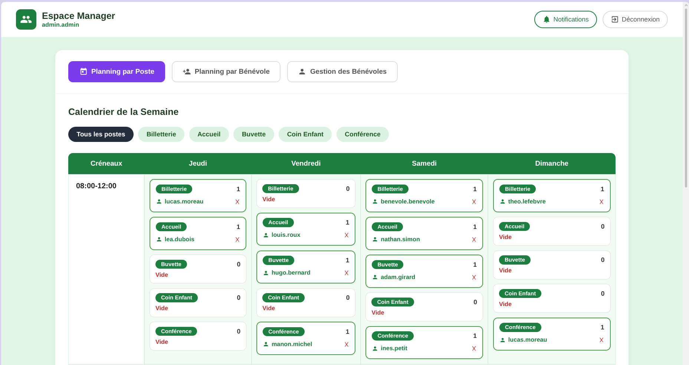

# Ping

Plateforme de gestion des bénévoles pour un événement : planning des créneaux, inscriptions, affectations par poste et notifications.

<p align="center">
  
</p>

## Fonctionnalités

- **Bénévoles** : consulter les créneaux disponibles, s'inscrire ou se désinscrire, gérer son profil et ses disponibilités.
- **Managers** (un par poste : buvette, billetterie, accueil, coin enfant, conférence) : créer des créneaux, affecter des bénévoles, gérer leur équipe.
- **Admin** : vue globale de tous les créneaux et bénévoles, création de comptes.
- **Notifications** dans l'application, et **emails** envoyés à la création d'un compte (identifiants) et à chaque affectation (avec le lien du groupe WhatsApp du poste).
- Authentification **JWT** avec trois rôles : `user`, `manager`, `admin`.

## Stack

| Couche      | Technologies                                         |
|-------------|------------------------------------------------------|
| Frontend    | React 19, React Router 7, Create React App           |
| Backend     | Java 21, Quarkus 3.17, Hibernate ORM Panache, SmallRye JWT |
| Base        | PostgreSQL 17                                        |
| Déploiement | Docker Compose, nginx (sert le front et proxifie `/api`) |

## Démarrage rapide (Docker)

Prérequis : Docker avec le plugin Compose, ou Podman.

```bash
cd ping
docker compose up --build
```

| Service    | URL                                  |
|------------|--------------------------------------|
| Frontend   | http://localhost:3000                |
| API        | http://localhost:8080/api            |
| Swagger UI | http://localhost:8080/q/swagger-ui   |

Arrêter : `docker compose down`. Pour effacer aussi la base : `docker compose down -v`.

## Développement local (hot reload)

Prérequis : Java 21, Maven 3.9+, Node 20+.

**1. Base de données**

```bash
docker run -d --name ping-db -p 5432:5432 \
  -e POSTGRES_DB=ping -e POSTGRES_USER=postgres -e POSTGRES_PASSWORD=postgres \
  postgres:17
```

**2. Backend** (port 8080)

```bash
cd ping
mkdir -p /tmp/ping
FILESYSTEM_DEFAULT_PATH=/tmp/ping mvn quarkus:dev
```

Le schéma est créé ou mis à jour automatiquement au démarrage.

**3. Frontend** (port 3000)

```bash
cd ping/frontend
npm install
npm start
```

Le proxy de CRA envoie les appels `/api/...` vers `http://localhost:8080`.

## Comptes de démo

Sur une base vide, `DataSeeder` crée un événement de démo au premier démarrage : un planning complet du jeudi au dimanche (60 créneaux sur les 5 postes, dont environ la moitié déjà pris), 13 bénévoles avec leurs disponibilités et quelques notifications.

| Rôle      | Login                 | Mot de passe  |
|-----------|-----------------------|---------------|
| Admin     | `admin.admin`         | `admin`       |
| Bénévole  | `benevole.benevole`   | `benevole`    |
| Bénévole  | `lea.dubois`, `hugo.bernard`... (12 autres) | `benevole` |
| Manager   | `manager.buvette`     | `buvette`     |
| Manager   | `manager.billetterie` | `billetterie` |
| Manager   | `manager.accueil`     | `accueil`     |
| Manager   | `manager.coinenfant`  | `coinenfant`  |
| Manager   | `manager.conference`  | `conference`  |

Les données de démo ne sont créées que si la table des créneaux est vide. Pour repartir de zéro : `docker compose down -v`.


## Configuration

Variables d'environnement lues par le backend (valeurs par défaut dans `ping/src/main/resources/application.properties`) :

| Variable                       | Défaut                                   |
|--------------------------------|------------------------------------------|
| `QUARKUS_DATASOURCE_JDBC_URL`  | `jdbc:postgresql://localhost:5432/ping`  |
| `QUARKUS_DATASOURCE_USERNAME`  | `postgres`                               |
| `QUARKUS_DATASOURCE_PASSWORD`  | `postgres`                               |
| `FILESYSTEM_DEFAULT_PATH`      | `/var/www/projects`                      |
| `LOG_FILE`                     | `Log.txt`                                |
| `ERROR_LOG_FILE`               | `ErrorLog.txt`                           |

## API

Toutes les routes sont préfixées par `/api`. La documentation complète est dans Swagger UI.

| Ressource         | Routes principales |
|-------------------|--------------------|
| `/user`           | `POST /login`, `GET /refresh`, CRUD des utilisateurs |
| `/benevole`       | `GET/PUT /me`, `GET /all`, `PUT/DELETE /{id}` |
| `/creneau`        | `GET /all`, `GET /mes-creneaux`, `POST`, `PUT /{id}/inscription`, `PUT /{id}/desinscription`, `PUT /{id}/assign/{benevoleId}`, `DELETE /{id}` |
| `/notification`   | `GET /me`, `GET /me/unread-count`, `PUT /me/read-all` |

## Structure

```
ping/
├── docker-compose.yml
├── Dockerfile                  # build Maven puis image JRE 21
├── pom.xml
├── src/main/java/fr/epita/assistants/ping/
│   ├── presentation/rest/      # endpoints REST
│   ├── service/                # logique métier
│   ├── data/                   # entités, repositories, DataSeeder
│   ├── request/ response/      # DTO
│   └── utils/                  # JWT, hash, emails, logs
└── frontend/
    ├── Dockerfile              # build React puis nginx
    ├── nginx.conf
    └── src/pages/              # Login, UserDashboard, AdminDashboard
```

## Équipe

Projet réalisé par le Groupe 7 (EPITA) : Noé Belperin, Anatole Debus, Etan Delabie, Aymeric Leclerre-Lemoine.
